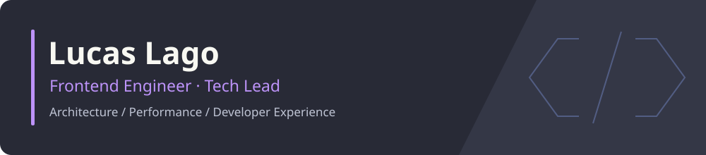

## About

I'm a frontend engineer with experience leading a team of seven developers and building multi-brand web platforms. My work focuses on scalable frontend architecture, web performance, reusable components and developer experience.

I have led initiatives involving server-side rendering, design systems, white-label architecture and progressive web applications. I'm currently expanding my React expertise and deepening my knowledge of software architecture and system design.

## Technology

**Frontend**

**Backend & tooling**

## Engineering focus

- Frontend architecture and multi-brand platforms
- Web performance, SSR and Core Web Vitals
- Design systems and reusable UI components
- Automated testing and developer tooling
- Technical leadership and engineering collaboration

## GitHub activity

<picture>
  <source media="(prefers-color-scheme: dark)" srcset="https://github-readme-stats.vercel.app/api?username=lucasslago1&amp;show_icons=true&amp;theme=dracula&amp;hide_border=true" />
  
</picture>

<picture>
  <source media="(prefers-color-scheme: dark)" srcset="https://raw.githubusercontent.com/lucasslago1/lucasslago1/output/github-snake-dark.svg" />
  
</picture>
